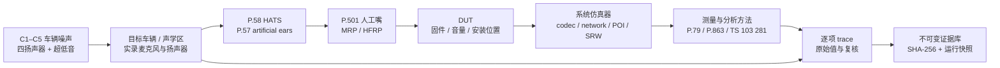

# P.1100 / P.1110 / P.1120 声学测试系统

## 目标与边界

本系统把车载免提终端的标准范围、测试拓扑、夹具标定、噪声场、DUT/网络路径、
信号与方法包、测量证据和逐项判定串成一条可审计链路。

它有三个互不升格的执行模式：

| 模式 | 输入 | 输出 | 不证明什么 |
| --- | --- | --- | --- |
| `simulation` | 工程 PCM 与已有场景 | 逐项“未测”和仿真诊断 | 不证明任何声学标准条款 |
| `precompliance` | 服务器核验过的测量证据包 | 按工作簿限值的预合规诊断 | 不自动等同正式标准 |
| `formal` | 标准正文、C1–C5、校准与硬件、DUT、方法包、原始 trace、复核 | 可审计的正式候选结果 | 当前工作簿仍非官方条款全集 |

所有运行的 `standard_compliance` 恒为 `false`。网站不把 STOI、SI-SDR、DNSMOS 或工程 ERLE
改名为 MOS、TCLw、RTD、SLR 或 RLR。正式合规还需测试所质量系统、独立签署和适用版本的标准正文。

## 标准适用范围

| 业务带宽 | 标准 | 本地正文状态 |
| --- | --- | --- |
| NB | ITU-T P.1100 (10/2025) | 官方版本已确认，正文未在本地核验 |
| WB | ITU-T P.1110 (10/2025) | 官方版本已确认，正文未在本地核验 |
| SWB | ITU-T P.1120 (10/2025) | PDF 与抽取文本已固定 SHA-256 |
| FB | ITU-T P.1120 (10/2025) | 同上；NV200 表没有 FB 行 |

官方入口：

- [P.1100](https://www.itu.int/rec/T-REC-P.1100/en)
- [P.1110](https://www.itu.int/rec/T-REC-P.1110/en)
- [P.1120](https://www.itu.int/rec/T-REC-P.1120/en)

本地 P.1120 证据：

- `build/itut-standards-20261010/P.1120.pdf`
- `build/itut-standards-20261010/P.1120.txt`

当前 NV200 的 336 行带有工作簿阈值，但每一行标明“客户工作簿限值，尚未逐条核对当前标准条款”。
系统不会把这些阈值自动升级成官方标准限值。NB/WB 正式运行还必须提供可核验的正文证据，
且把每一项工作簿限值与现行条款重新对齐。

条款对齐必须作为独立 `limit_reconciliation` 证据上传。正文 PDF 只证明使用哪一版标准，
不能代替逐条映射。核对文件绑定 NV200 合同的 SHA-256、标准身份和人工复核人，
并完整覆盖所选带宽的全部合同行；重复、缺行、多余行或合同版本不符都会阻断正式门禁。

## 声学拓扑



系统要求至少五个校准点：`HATS_MRP`、`HATS_DRP`、`HFRP`、`POI_SEND`、`POI_RECEIVE`。
标定证据必须位于服务器证据库，提供可重算的 SHA-256；路径穿越、符号链接和内容篡改都会被拒绝。

## 车辆与噪声场

P.1120 规定用时间同步的车辆录音重现驾驶噪声。四扬声器与超低音是最低推荐结构；
阵列或方向性麦克风场景需要按 ETSI TS 103 224 做幅相受控的空间重现。

验收条件：

- A 计权重放偏差不超过 ±1 dB。
- 100 Hz–10 kHz 三分之一倍频程功率谱偏差不超过 ±3 dB。
- 噪声场景的录音应靠近免提麦克风，并在通话时 HVAC 设置下录制。
- C1–C4 为常规场景，C5 为可选市场条件；一旦声明 C5，也必须提供证据。

| 场景 | 描述 | 车速 | 噪声场设置 |
| --- | --- | ---: | --- |
| C1 | 静止怠速 | 0 km/h | 最低风量 |
| C2 | 城市道路 | 60 km/h | 中风量，吹向车窗 |
| C3 | 高速 | 120 km/h | 最低风量 |
| C4 | 高速 | 120 km/h | 中风量，吹向车窗 |
| C5 | 高速市场条件 | ≥160 km/h | 最低风量 |

所有场景均要求车窗关闭、雨刮关闭、转向灯关闭、无背景说话人、干燥粗糙路面且无明显脉冲颠簸、
风速低于 5 m/s、无降水、温度在 −20 至 40 ℃。

Suzuki 等平滑路面或产生显著脉冲的路面不能替代标准 C1–C5 录入。

## 关键测量

| 测量族 | 核心标准口径 | 必备证据 |
| --- | --- | --- |
| 时延 | P.1120 §11.2 | MRP/POI/DRP 物理回环、编解码、时间戳 |
| SLR/RLR | §11.3 + P.79 | 校准 MRP/POI/DRP、两个人工耳、音量档 |
| 频响 | §11.4 表和容差掩模 | 三分之一倍频程、归一化位置、完整频带 |
| 语音质量 | §11.5/11.6 + P.863 | 获批 POLQA 构建、准确输入、稳定性序列 |
| 空闲噪声 | §11.7 | 激活后的 1 s 窗、A 计权、ECMA 418-2 音调度 |
| 发送/接收失真 | §11.9/11.10 | 规定正弦信号、200 ms 或规定时长、线性接入点 |
| 回声 | §11.11 | 物理声耦合、训练、TCL/TCLw/时变路径 |
| 双讲/切换 | §11.12/11.13 | 指定竞争序列、双侧端点、分类规则 |
| 噪声中语音 | §11.14.3 | C1–C5 + ETSI TS 103 281 的 N/S/G-MOS |
| CNG | §11.14.6 | 原始噪声、CNG 输出、电平和频谱掩模 |

P.1120 提供的示例门限包括：无 SRW 的 RTD 应低于 170 ms；SRW 下实现相关时延应低于 70 ms，
若与手机配对则加上实际 SRW 时延。工程上更优的目标为 70 ms 以下。标准具体限值以当前条款为准，
本文件不把工作簿历史测量或工程指标当成正式结果。

## 执行流程

1. 在“声学测试系统”选择业务带宽、连接方式和运行模式。
2. 上传或编译证据。服务器复制原始文件并生成 SHA-256；相同哈希会在每次运行前重新核验。
3. 提交五个校准点、C1–C5（C5 可选）、DUT、硬件、方法包、信号包和测量包。
4. `POST /api/acoustic/runs` 生成不可变计划与门禁快照。
5. `POST /api/acoustic/runs/{run_id}/execute` 执行。仿真只返回诊断和“未测”；
   导入模式只按已核验 bundle 中的原始 item ID、单位和值做客户工作簿判定。
6. 结果写入 `build/acoustic-qualification/executions/<execution_id>/results.json`，
   并生成文件哈希。缺失、无效、NaN 和非数值条目保留为明确状态，不会补成 0 或通过。
7. 正式结论由测试所独立复核。系统仍保留 `standard_compliance=false`，直到所有官方条款和
   认证证据完成签署。

## 一键工程自检边界

`POST /api/alignment/run` 是工程自检入口，不是正式声学验收：

- `full`：对固定车辆场景运行一次 CLI，再执行契约、方法指标和声学门禁三组 pytest。
- `methods` / `contract`：只运行对应 pytest，不启动音频 CLI。
- 严格模式会把所选测试中的跳过项判为失败；普通模式允许跳过项但仍如实显示。
- `vcp_default` 在 API 中保留原 id，实际调用固定 CLI 的 `vcp` profile。
- 只有 CLI 退出码、profile、报告字段、输出 WAV 与 pytest/JUnit 结果同时有效，工程自检才通过。
- 所有结果始终是 `standard_compliance=false`、`formal_test_status=not_measured`。该按钮不执行
  8 模式或 336 项正式测量，也不能替代校准、原始 trace、实验室复核和标准条款对齐。

## 测量包契约

`measurement-bundle` 是一个 JSON evidence 文件：

```json
{
  "schema_version": 1,
  "backend": {
    "name": "imported",
    "version": "testhouse-1.0",
    "identity_sha256": "<64 hex>"
  },
  "measurements": [
    {
      "item_id": "SWB-wireless:B2",
      "value": 87.2,
      "unit": "Calculated Value [ms]",
      "method_id": "P1120-11.2-testhouse-1",
      "recorded_at": "2026-10-19T00:00:00Z",
      "trace": {
        "path": "measurement-run-01/capture.wav",
        "sha256": "<64 hex>",
        "kind": "measurement_trace"
      },
      "source_identity": {
        "reference_sha256": "<64 hex>",
        "capture_sha256": "<64 hex>"
      },
      "notes": "physical RTD corrected for instrument loopback"
    }
  ]
}
```

服务端会拒绝未知 item ID、重复 item ID、单位不匹配、trace 不存在、trace 哈希改变。
导入 bundle 的实际来源由 `backend.name` / `backend.version` / trace 记录。

## 数字证据编译器

现有项目提供三种只能用于诊断/预合规入口的编译方式：

- `loopback`：两组原生采样率 PCM 的峰值互相关，输出 ms；没有夹具时延扣除或校准就不属于正式 RTD。
- `noise`：明确噪声区间内 RMS 为 dBFS；不能自动换成 dBPa、dBm0 或声学空闲噪声。
- `transfer`：重叠平均 H1 响应和 coherence；必须提供官方 mask、归一化位置和固定延迟。

PCM 路径必须位于项目 `build/` 下，原始文件会复制到证据库。服务端拒绝不安全的路径。
这个编译器用于把实车/实验室输出的真实 trace 纳入服务器证据链，不生成假测量。

频响掩码比较前，先在 `normalized_at_hz` 处把整条响应归零。P.1120 §11.4
采用任意标度的灵敏度，测试步骤要求每个三分之一倍频程都以完整的参考信号平均电平归一化；
因此固定链路增益不应造成掩码平移。归一化频率必须位于掩码频带内，缺失或越界直接拒绝。

## 客户限值条款映射契约

`limit_reconciliation` 文件格式：

```json
{
  "schema_version": 1,
  "contract_sha256": "<current nv200-test-contract.json sha256>",
  "standard": "P.1120",
  "standard_edition": "2025-10",
  "standard_sha256": "<verified standard text sha256>",
  "prepared_at": "2026-10-19T00:00:00Z",
  "reviewer": "independent reviewer",
  "mappings": [{
    "item_id": "SWB-wired:B5",
    "clause": "11.4.2",
    "table_or_figure": "Table 11-3",
    "official_limit": "-10..8 dB mask",
    "customer_limit": "conforms to frequency-response mask",
    "disposition": "review",
    "note": "frequency and direction mapping checked"
  }]
}
```

当前合同各带宽的行数：NB 126、WB 126、SWB 84、FB 0。FB 没有 NV200 行，
正式结论只能使用 P.1120 官方条款和证据，不能拿 NB/WB/SWB 的客户行补位。

## 运行与验证

```bash
npm run dev:all
```

- 前端：`http://127.0.0.1:5173/#acoustic`
- 后端：`http://127.0.0.1:8001/api/acoustic/catalog`

最小验证：

```bash
/home/zhangqingtian/.venv/bin/python -m pytest \
  tests/test_acoustic_qualification.py \
  tests/test_itut_alignment.py \
  tests/test_itu_method_metrics.py -q
npm run build
npm test
```

服务端测试覆盖正式模式必须确认、缺证据阻断、仿真不得升格、哈希篡改、
路径逃逸、单位不一致、噪声场景不一致和 PCM 证据编译。

## 数据目录

| 路径 | 内容 |
| --- | --- |
| `server/acoustic/catalog.json` | 标准、拓扑、C1–C5、P.1120 掩模（可跟踪源文件） |
| `cpp/evaluation/nv200-test-contract.json` | 336 行客户工作簿契约，历史值不是当前测量 |
| `build/acoustic-qualification/evidence/` | 不可变证据文件与 JSON 索引 |
| `build/acoustic-qualification/runs/` | 计划、门禁和不可变运行快照 |
| `build/acoustic-qualification/executions/` | 逐项执行结果和结果哈希 |

## 尚需现场提供的证据

- P.1100 / P.1110 (10/2025) 正文以及每个客户限值的条款对齐。
- 目标车辆 C1–C5 的原始噪声录音、HVAC 和车辆设置记录。
- HATS/P.57 人工耳、人工嘴、测麦、声卡、系统仿真器和全部校准证书。
- DUT 固件、安装位置、音量、codec/网络和 SRW 身份。
- 获批 P.863/POLQA、ETSI TS 103 281、P.501 signal pack 及其内容哈希。
- 每项测量的原始 input/output、仪器设置、分析脚本版本和独立复核签署。

当前实现仍不包含 HATS/labCORE 等仪器的实时控制适配器；实验室测量通过证据上传和测量包导入，
或在 `MeasurementBackend` 接口上补充具体厂家的控制实现。
